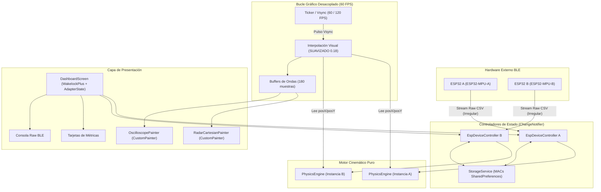

# ESP32 BLE Telemetry Station

Estación móvil de monitoreo telemétrico en tiempo real desarrollada en **Flutter nativo** para **Android**, diseñada para recibir, procesar y renderizar datos inerciales de dos dispositivos **ESP32** equipados con acelerómetros **MPU-6050**.

---

## 📌 Descripción del Proyecto

La aplicación actúa como una estación base telemétrica que se conecta de manera simultánea e independiente a dos nodos sensores:
- **ESP A** (Turquesa · `#00FFCC` · `ESP32-MPU-A`)
- **ESP B** (Naranja · `#FF5722` · `ESP32-MPU-B`)

Los microcontroladores transmiten datos crudos de aceleración vía **Bluetooth Low Energy (BLE)** mediante el protocolo Nordic UART Service (NUS). La app procesa las lecturas a través de un **motor de física cinemática en Dart**, aplicando filtrado anti-picos, remoción de gravedad dinámica y detección de reposo (ZUPT), renderizando a **60 FPS constantes** en un radar cartesiano 2D y osciloscopios de ondas.

> [!NOTE]
> **Firmware de los microcontroladores**: El código fuente del firmware de los ESP32 **no está incluido** en este repositorio. Este proyecto comprende exclusivamente la aplicación cliente de visualización y procesamiento telemétrico para Android.

> [!TIP]
> **Material de Referencia Histórico**: En el directorio [`docs/legacy-reference`](docs/legacy-reference) se conserva el prototipo web original (HTML5/Canvas/Web Bluetooth). Este material se incluye únicamente con fines de documentación y referencia de diseño; **no forma parte del proceso de compilación ni del build nativo de Flutter**.

---

## 🏗️ Arquitectura del Sistema

La arquitectura está construida con separación estricta entre la recepción asíncrona de radiofrecuencia y el bucle de presentación gráfica:



### Principios de Diseño:
1. **Desacoplamiento Total a 60 FPS**: Los paquetes BLE llegan a frecuencia irregular por fluctuaciones de radio. La llegada de un paquete **solo actualiza las variables en memoria** del `PhysicsEngine`. El repintado visual lo conduce un `Ticker` sincronizado con el refresco de pantalla que interpola la posición visual (`SUAVIZADO_VISUAL = 0.18`).
2. **Controladores Independientes**: Cada placa es gestionada por un `EspDeviceController` aislado, evitando bloqueos mutuos.
3. **Reconexión Persistente con Backoff**: Las direcciones MAC se guardan localmente con `SharedPreferences`. Ante caídas de enlace, un bucle de reintento activo con retroceso exponencial ($2.0\text{ s} \to 10.0\text{ s}$) intenta reconectar sin saturar las ranuras GATT de Android.
4. **Wakelock Inteligente**: Mediante `wakelock_plus`, la pantalla permanece encendida automáticamente mientras haya al menos una placa conectada.
5. **Monitoreo de Radio Bluetooth**: Escucha reactiva de `FlutterBluePlus.adapterState` con banner interactivo para solicitar el encendido del Bluetooth (`FlutterBluePlus.turnOn()`).

---

## 📡 Protocolo BLE (Nordic UART Service)

La comunicación serial sobre BLE utiliza el perfil estándar NUS:

| Parámetro | UUID / Valor | Descripción |
| :--- | :--- | :--- |
| **Service UUID** | `6e400001-b5a3-f393-e0a9-e50e24dcca9e` | Servicio Nordic UART |
| **TX Characteristic** | `6e400003-b5a3-f393-e0a9-e50e24dcca9e` | Notificaciones continuas del ESP32 a la app |
| **Formato de Trama** | `rawX,rawY\n` (Texto UTF-8 ASCII) | Valores crudos de aceleración del sensor |
| **Delimitador** | `\n` (Salto de línea) | Reensamblado con buffer circular |

---

## ⚙️ Motor de Física (`PhysicsEngine`)

El motor cinemático (`lib/core/physics/physics_engine.dart`) es código Dart puro y desacoplado:
- **Factor de conversión**: $9.81 / 16384.0\text{ m/s}^2$ por LSB (rango $\pm 2g$).
- **Filtro Anti-Picos Adaptativo**: Descarta lecturas $> 35\text{ m/s}^2$ y picos aislados $> 15\text{ m/s}^2$, pero se adapta a un nuevo nivel si el cambio persiste por 3 muestras consecutivas.
- **Filtro Pasa-Altos (Gravedad dinámica)**: $\alpha = 0.02$, absorbe lentamente la inclinación de reposo para extraer la aceleración lineal dinámica pura.
- **Filtro EMA**: $\alpha = 0.35$ para suavizar ruido electromagnético.
- **ZUPT (Zero Velocity Update)**: Detecta inactividad ($> 300\text{ ms}$ en reposo bajo zona muerta $0.08\text{ m/s}^2$), aplicando desaceleración exponencial ($0.55$) y un resorte elástico que devuelve la posición al centro.
- **Límites de Rebote**: Restringe la posición a $\pm 58\text{ cm}$.

---

## 📱 Requisitos y Permisos

- **Plataforma Objetivo**: Android (SDK mínimo: API 21+, optimizado para Android 12+ API 31+).
- **Permisos en `AndroidManifest.xml`**:
  - `BLUETOOTH_SCAN` con el atributo `android:usesPermissionFlags="neverForLocation"` (escaneo BLE sin solicitar ubicación geográfica continua en Android 12+).
  - `BLUETOOTH_CONNECT` (conexión e intercambio GATT en Android 12+).
  - Permisos legacy para Android 10 y 11: `BLUETOOTH`, `BLUETOOTH_ADMIN`, `ACCESS_FINE_LOCATION` (`maxSdkVersion="30"`).

---

## 🚀 Instrucciones de Instalación y Ejecución

### Prerrequisitos
- Flutter SDK $\ge 3.13.0$
- Android SDK instalado con dispositivo físico o emulador con soporte Bluetooth LE.

### Pasos

1. **Clonar el repositorio**:
   ```bash
   git clone https://github.com/Santiajo/esp32-ble-telemetry.git
   cd esp32-ble-telemetry
   ```

2. **Instalar dependencias**:
   ```bash
   flutter pub get
   ```

3. **Ejecutar pruebas automatizadas**:
   ```bash
   flutter test
   ```

4. **Verificar análisis de código**:
   ```bash
   flutter analyze
   ```

5. **Lanzar en un dispositivo Android**:
   ```bash
   flutter run -d <android-device-id>
   ```
